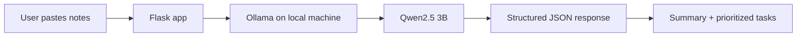

# 🦥 SlothBrief — Less sorting. More breathing room.

**SlothBrief turns messy notes into a calm, prioritized plan using an open-weight AI model running locally.** Paste tasks, reminders, or meeting notes and get a concise summary, suggested next steps, and a gentle tip—without relying on a hosted AI API.

Built for the DEV Community **Slow and Steady** open-source AI challenge.

## Features
- 🧠 Summarizes free-form notes with Qwen2.5 3B.
- 🪴 Suggests actions and High / Medium / Low priorities.
- 🔒 Sends prompts to local Ollama rather than a third-party AI API.
- 📴 Can run offline after dependencies and model weights are installed.
- 🧩 Swap compatible models using an environment variable.
- 📱 Responsive interface with no frontend build step.

## How it works



## Run locally

1. Install [Ollama](https://ollama.com), then run:

   ```bash
   ollama pull qwen2.5:3b
   ```

2. Clone this repository and enter the folder:

   ```bash
   git clone https://github.com/YOUR-USERNAME/slothbrief.git
   cd slothbrief
   python3 -m venv .venv
   source .venv/bin/activate
   pip install -r requirements.txt
   ```

   Replace `YOUR-USERNAME` with your actual GitHub username/repository.

3. Start Ollama (open the Ollama app if it is not already running). Check the model is installed:

   ```bash
   ollama list
   ```

4. Start the web app:

   ```bash
   python app.py
   ```

5. Open http://127.0.0.1:5000.

## Choose another model

The default is `qwen2.5:3b`. If another compatible model is installed in Ollama:

```bash
OLLAMA_MODEL=your-model-name python app.py
```

The default Ollama endpoint is `http://127.0.0.1:11434/api/generate`; override `OLLAMA_URL` if needed.

## Privacy and limitations

- In the default setup, notes go to Ollama on the same computer, not to a hosted AI API.
- After setup, generation can work without internet.
- This app does not save notes to a database. The machine's OS, backups, and other software remain outside the app's control.
- AI priorities are suggestions; review them.
- The development server binds to `127.0.0.1` and is not intended to be exposed directly to the public internet.
- A cloud deployment cannot access Ollama running on your laptop at `localhost`. Hosted deployment requires a separately reachable inference service. Do not expose your local Ollama port publicly without a properly secured architecture.

## Tech stack
- [Qwen2.5 3B](https://ollama.com/library/qwen2.5) — open-weight language model
- [Ollama](https://ollama.com) — local model runtime
- [Flask](https://flask.palletsprojects.com/) — Python web framework
- HTML, CSS, JavaScript

## Why open innovation matters

Local inference gives users more control over where personal text is processed. After setup, the app can work offline, and the model can be swapped for another compatible model. The trade-offs are local compute requirements and the possibility that a smaller model misunderstands context. SlothBrief keeps the human in charge: its output is a suggestion, not an unquestionable answer.

## License
MIT. See [LICENSE](LICENSE).
